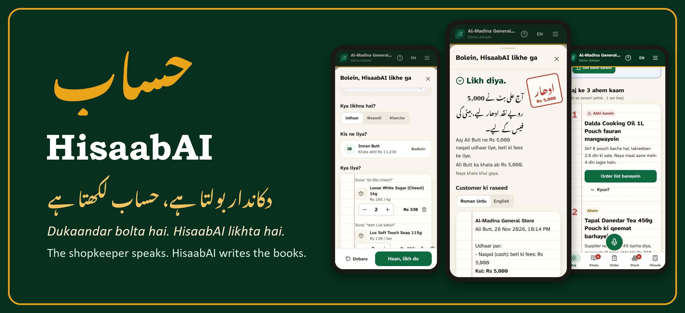
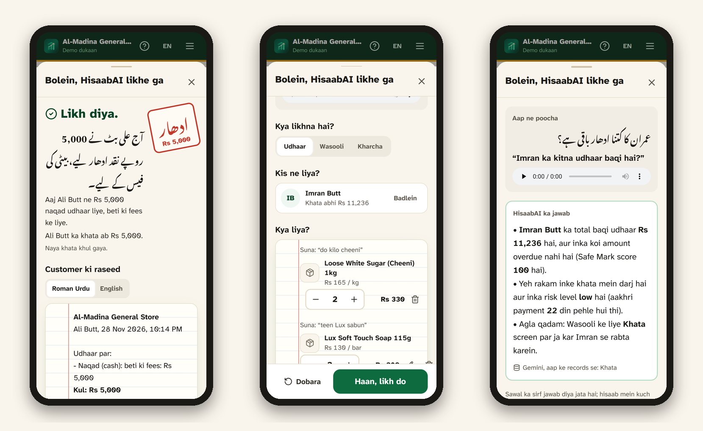
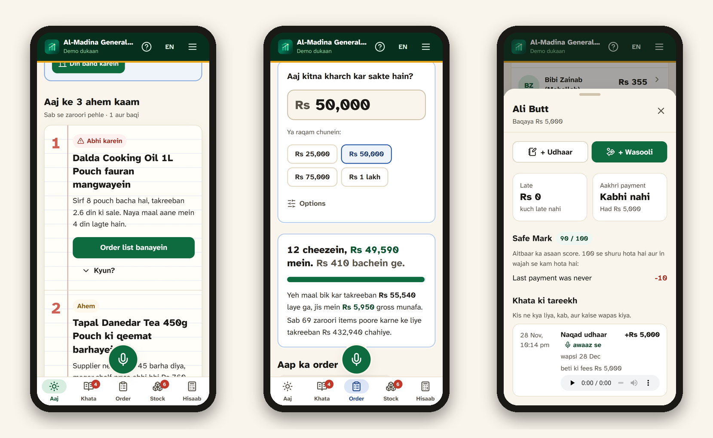
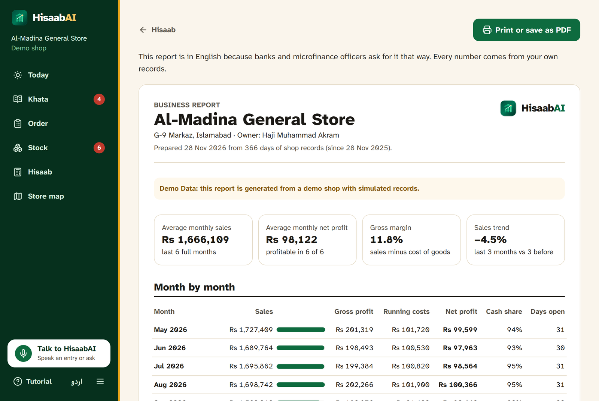
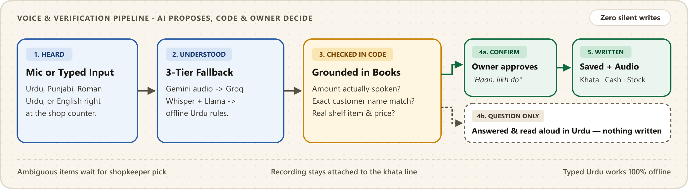
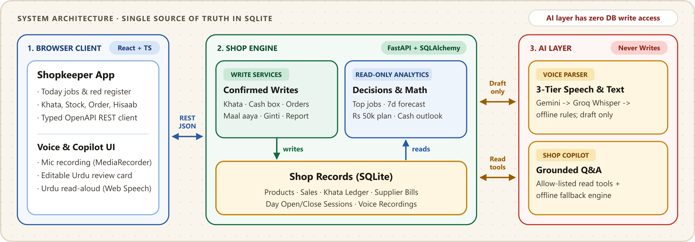

<div align="center">



# HisaabAI

**The voice-first bookkeeper for Pakistan's karyana stores.**
The shopkeeper says what happened in Urdu. HisaabAI writes the khata, the cash box and the stock,
and every morning tells him the three jobs that save him money.

[](#)
[](#)
[](#tested-not-mocked)
[](#speak-it-check-it-its-in-the-books)

**[Live demo](#)** &nbsp;·&nbsp; **[2-minute video](#)** &nbsp;·&nbsp; **[Pitch deck](pitch/HisaabAI_Pitch.pdf)** &nbsp;·&nbsp; **[Run it locally](#run-it-locally)**

</div>

<!-- Before submission: put the deployed URL and the video link in the two links above. -->

---

## The problem

Pakistan has about **a million karyana stores** ([Karandaaz](https://karandaaz.com.pk/?p=7762)), and only about
**151,000 retailers out of 5 million+ have a POS machine** ([SBP data via ProPakistani](https://propakistani.pk/2025/06/22/only-3-of-5-million-retailers-accept-digital-payments-via-pos-machines-sbp/)).
The rest run on a red paper register, and they leak money in the same three places:

| | The leak | In the demo shop, today |
|---|---|---|
| 📦 | **The fast seller runs out**, and the customer walks to the next shop | Dalda oil: 2.6 days left, delivery takes 4 |
| 📉 | **The distributor quietly raises the rate**, the shelf price doesn't move | Tapal: cost up Rs 45, margin down from 9.2% to 3.3% |
| 📒 | **Udhaar comes back late**, or never | Tariq Bhai: Rs 30,696, 76 days late |

Typing tools have not reached the counter, because a shopkeeper with a queue does not type. And even
where records exist, nothing turns them into a decision.

## Speak it, check it, it's in the books

Press the mic and say it the way you'd tell a munshi:



| He says | HisaabAI writes |
|---|---|
| *"Aaj Ali Butt mujh se paanch hazaar rupay udhaar le kar gaya, beti ki fees ke liye"* | A new khata for Ali Butt, Rs 5,000 **cash** udhaar with the reason; the cash box is Rs 5,000 lighter |
| *"Imran do kilo cheeni aur teen Lux sabun le gaya"* | Imran Butt's khata: 2 kg sugar and 3 Lux soaps at **his own shelf prices**; stock goes down |
| *"Imran ne do hazaar wapas diye, Easypaisa pe"* | A wasooli of Rs 2,000 by Easypaisa (not into the cash box) |
| *"Bijli ka bill saadhe teen hazaar diya"* | Rs 3,500 electricity kharcha from the cash box |
| *"Imran ka kitna udhaar baqi hai?"* | Nothing is written: the answer comes from his khata, read aloud in Urdu |

Every entry first appears as a card in **Urdu script and Roman Urdu**, with what was heard and
the recording. The shopkeeper fixes anything with a tap, then says **"Haan, likh do"**. The red
ادھار stamp lands, a receipt is ready to show the customer, and the recording stays on the khata line
as proof if a customer ever says *"maine itna nahi liya"*.

## A shopkeeper's whole day



| When | What HisaabAI does |
|---|---|
| **Morning** | Count the cash box to open the day. Any difference from the records is written down, so every cash number after it is real. **Today's 3 jobs** sit at the top: what runs out first, which price to fix, who to collect from, each with the reason and the numbers. |
| **At the counter** | Udhaar with items or cash, wasooli by cash, Easypaisa, JazzCash or bank, kharcha. By voice or with the buttons. **"Udhaar dun?"** answers *yes / careful / no* with the reasons, before more credit is given. |
| **The order booker visits** | One Order screen. *Booker is here:* what to order from this distributor and **how much the cash box can safely spend**. *Whole shop, one budget:* "I have Rs 50,000, what do I buy?", in whole cartons, most urgent first, **never one rupee over budget**, saved as one order per distributor. |
| **Maal aaya** | Check the delivery against the bill. Short items and rate rises are flagged with the new margin and a one-tap price fix; the bill joins what the shop owes. |
| **Ginti** | Count a shelf. Stock is corrected and the shortfall is booked as a loss or as sales nobody wrote down. |
| **Night** | Count the cash box again and see the day in register lines. **Tomorrow's brief** (bills due, bookers visiting, customers to remind) stays on the home screen until morning. |
| **Any time** | Ask in Roman Urdu or English. A 7-day cash outlook, a Safe Mark score for every customer, margin-squeeze and dead-stock alerts. |

### Records that open credit



A karyana store can't get a loan because, on paper, it has no history. Every udhaar, wasooli and cash
count in HisaabAI builds that history, and one tap prints a **business report** a bank or microfinance
officer can read: six months of sales, profit after running costs, khata, supplier bills and how well the
books were kept. Together with Urdu and regional-language voice bookkeeping, this places HisaabAI across
**Track 3 (FinTech & Financial Inclusion)** and **Track 5 (Urdu & Regional Tech)**.

## Why you can trust the numbers

With money, trust beats magic. The AI understands and explains; **the shop's own books decide**.

 Understood via Gemini, Groq Whisper or offline Urdu rules -> Checked in code against spoken amounts, exact customer names and shelf prices -> Owner approves with Haan likh do to save to khata, cash box and stock with audio proof, or Question Only is answered aloud without writing anything." width="100%">

- **Nothing is written until the shopkeeper confirms.** A question is only answered, never written.
- **An amount is kept only if it was really said.** If the AI says Rs 50,000 but he said *"paanch hazaar"*,
  the AI's number is thrown away. Spoken amounts like *dhai sau*, *sawa do hazaar* and *dedh lakh* are
  parsed by our own code.
- **Prices and balances come from the books, never from the AI.** Items are matched to the shelf by
  our own matcher. When two products fit (*"Dalda": oil or ghee?*), the shopkeeper chooses.
- **A shared surname is not a match.** "Ali Butt" is never written into Imran Butt's khata.
- **Copilot answers with numbers but no data behind them are discarded**, and the offline engine answers instead.
- **It never gets stuck.** If Gemini is busy or a model is retired, other models are tried, then Groq,
  then offline rules. Typed Urdu works with no internet at all.
- **No messages are sent.** Receipts, reminders and orders are drafts to show, read out or copy.
  No WhatsApp or SMS integration, so no customer number leaves the shop. Voice goes to an online AI
  only after the owner says yes; it is off by default.

## How it's built



| Part | Where | What it does |
|---|---|---|
| Voice entry | `backend/app/voice/` | Urdu number words, name matching, item matching, offline parser, AI tiers, confirm and save |
| Workflows | `backend/app/services/` | Day open/close and kharcha, khata and the credit check, orders and Maal aaya, ginti, the business report |
| Analytics | `backend/app/analytics/` | Inventory risk, margin squeeze, dead stock, khata aging, payables, the cash book, Today's jobs |
| Budget plan | `backend/app/reorder/` | Whole cartons within a budget, used per distributor and for the whole shop |
| Forecast | `backend/app/forecasting/` | Calendar-aware smoothing (Ramadan, Eid, salary weeks) against two baselines, chosen by backtest |
| Copilot | `backend/app/copilot/` | Gemini and Groq function calling over read-only tools, plus an offline engine |
| Demo shop | `backend/app/simulator/` | A year of a realistic shop from a fixed seed |
| App | `frontend/src/` | React 18, TypeScript (strict), Vite, Tailwind, TanStack Query; the API client is generated from the backend's OpenAPI schema |

## Run it locally

**Backend** (Python 3.11+):

```bash
cd backend
pip install -r requirements.txt
cp .env.example .env          # optional; the defaults run the demo
uvicorn app.main:app --port 8000 --reload
```

The first start builds the demo shop (about 3 seconds). API docs: http://localhost:8000/docs

**Frontend** (Node 20+):

```bash
cd frontend
npm install
npm run dev                   # http://localhost:5173: landing page; the app is at /app
```

**Voice** needs the microphone, which browsers allow only on `localhost` or HTTPS. Set at least one key in
`backend/.env` (keys are read only from there or the environment, never stored or returned by the API):

| Setting | Purpose |
|---|---|
| `GEMINI_API_KEY` | Hears the audio and fills the entry (first choice) |
| `GROQ_API_KEY` | Whisper transcription and Llama, as the backup |
| `GEMINI_MODEL`, `GEMINI_FALLBACK_MODELS` | Which Gemini models to try, in order |
| `COPILOT_MODE` | `auto` (online first) or `offline` (never calls an AI) |

Without keys, everything still works: typed Urdu, the copilot's offline engine, and every screen.

## Tested, not mocked

```bash
cd backend && python -m pytest tests -q          # 205 tests on a temporary database
cd frontend && npm run typecheck
```

The tests check the books, not just the responses: the cash box after a cash loan, stock after goods on
udhaar, a plan that never exceeds its budget, orders saved all or nothing, and AI answers with invented
amounts thrown away.

Five end-to-end walkthroughs drive the real app in Microsoft Edge (`frontend/e2e/`). The voice ones play a
recorded sentence into a fake microphone and check the result all the way to the khata and the cash box:
`workflow.mjs` (the whole day), `voice.mjs`, `voice-goods.mjs`, `voice-ask.mjs` and `improve01.mjs`.
Run them only against a scratch backend; each file's header says how.

## Demo data, honestly

The demo is a **simulated** shop, *Al-Madina General Store* in G-9 Markaz, Islamabad: 120 real Pakistani
grocery products, 15 khata customers and 8 distributors, generated from a fixed seed. It covers the 12
months up to today, with weekday and salary-week patterns, Ramadan, Chaand Raat and both Eids, distributor
route days, customers with different paying habits, and a few nights when the cash box was short. Names
and phone numbers are fictional.

Everything is labelled *Demo data* in the app, and **simulated accuracy is never presented as real-world
accuracy.** On the simulated shop, our calendar-aware forecast has the lowest error of the three methods
on 14-day totals (21.1%, against 22.7% and 22.8%; see [docs/forecast_benchmark.md](docs/forecast_benchmark.md)).
The same test on a public dataset of real retail sales is ready to run:

1. Put `online_retail_II.xlsx` (UCI, link below) in `backend/datasets/raw/`.
2. `python scripts/build_public_benchmark.py datasets/raw/online_retail_II.xlsx` (from `backend/`)
3. `python scripts/forecast_benchmark.py`

## What's next

- **A 30-day pilot with 5 real shops** in Islamabad, on their own records (CSV import and voice).
- **One microfinance partner**, to turn a shop's records into its first loan.
- Voice that works offline, barcode and bill photos, more shop types.

## Disclosures (CYE 2026 rules)

- **Build window:** the repository's first commit is 26 November 2026, inside the 16–28 November build window.
- **Backend:** Python, FastAPI, Uvicorn, SQLAlchemy, Pydantic, pydantic-settings, NumPy, pandas,
  python-multipart, tzdata, SQLite; tests with pytest and httpx; openpyxl for the public benchmark only.
- **Frontend:** TypeScript, React, React DOM, React Router, Vite, Tailwind CSS, PostCSS, Autoprefixer,
  TanStack Query, Framer Motion, lucide-react, canvas-confetti, clsx, tailwind-merge, openapi-fetch,
  openapi-typescript. Browser APIs: MediaRecorder and Web Audio (recording), Web Speech synthesis (read-aloud).
- **Fonts:** Atkinson Hyperlegible Next and Noto Nastaliq Urdu (Google Fonts).
- **AI APIs (optional; the app works without them):** Google Gemini (`google-genai`) for voice understanding
  and the copilot; Groq (`groq`) for Whisper transcription and Llama 3.3 70B.
- **Public dataset:** "Online Retail II", D. Chen, UCI Machine Learning Repository,
  https://doi.org/10.24432/C5CG6D (CC BY 4.0), used only to evaluate the forecaster.
- **Statistics in this README and the deck:** Karandaaz (number of kiryana stores); State Bank of Pakistan
  data reported by ProPakistani (POS adoption). Links above.
- **Testing and pitch tooling:** playwright-core with Microsoft Edge (end-to-end walkthroughs and screenshots);
  pptxgenjs, sharp, react-icons and Pillow (the pitch deck and README images, in `pitch/deck/`).
- **Images:** the illustrations in `frontend/src/assets` were generated with Google Gemini. Product pack
  photos in `backend/static/images/products` are used for the demo only. App screenshots are of this app.
- **AI coding assistants:** this project was built with help from Claude Code by Anthropic.

<div align="center">
<br>
<br>
<sub><i>Dukaandar bolta hai. HisaabAI likhta hai.</i> &nbsp;·&nbsp; Capital Youth Expo 2026</sub>
</div>
