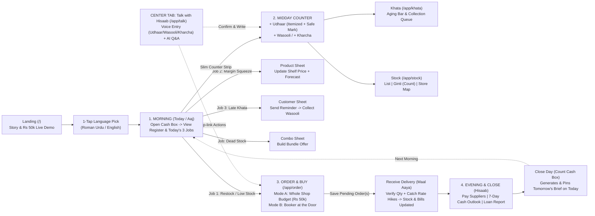

# HisaabAI — Workflow & Rhythm Improvement Plan (`improve01.md`)

## 1. Executive Summary & Core Diagnosis

HisaabAI already has strong individual features—the **Red Khata Register**, **Parchi** priority slips, **Galla** open/close reconciliation, **Order Booker** vs. **Budget Reorder Planner**, **Maal Aaya** rate-change detection, **Ginti** shelf counts, **Safe Mark** credit checks, and the **Roman Urdu Copilot**.

However, the application currently feels **out of rhythm** because:
1. **Two competing identities fight on the Home screen:** A fast *Counter Operations POS* (`+ Udhaar`, `+ Wasooli`, `Kharcha`) and a *Morning Decision Advisor* (`RegisterBook`, `Today's 3 jobs`, `30-day Sales Trend`).
2. **Two disconnected purchasing workflows:** `/app/order` (supplier-by-supplier, saves to `On the way`) and `/app/buy` (shop-wide Rs 50,000 knapsack optimizer, hidden from mobile bottom nav, cannot save orders to `On the way`).
3. **State-blind screens:** Opening and closing the shop (`not_opened`, `open`, `closed`) does not reshape what the Home screen emphasizes, and the "Tomorrow's Brief" vanishes once the close-day sheet is dismissed.
4. **Overlapping sheets & broken return paths:** Duplicate ways to pay customers, receive stock, and route to reorder screens—plus losing your place when opening nested flows from sheets.

---

## 2. Feature-by-Feature Audit: Current State, Gaps & Improvements

### A. Onboarding & Landing-to-App Transition
* **Files:** `frontend/src/pages/LandingPage.tsx`, `frontend/src/landing/DayStory.tsx`, `frontend/src/onboarding/Welcome.tsx`, `frontend/src/onboarding/Tour.tsx`
* **Current State:**
  * The Landing Page (`/`) walks visitors through the hero register, the 3 shop problems, the interactive 4-step `DayStory` (8 AM, 11 AM, 6 PM, Any time), and the live Rs 50,000 slider demo.
  * Clicking **"Open the demo shop"** (`/app`) launches `Welcome.tsx` (Step 0 language picker + 4 preview slides), followed immediately by `Tour.tsx` (8 sequential spotlight coach-marks).
* **Why Change:**
  * A user moving from the Landing Page into `/app` faces **13 sequential taps** (1 language pick + 4 slides + 8 spotlight steps) before they can touch the shop counter. Since `LandingPage` already explains the 4 workflows, the 4 preview slides feel repetitive and stall momentum—especially for mobile users or hackathon judges evaluating the live app quickly.
* **Recommended Improvement:**
  * Keep Step 0 (`Roman Urdu | English` selection) as a clean 1-tap gate with an optional **"Take 1-minute tour"** link, and drop users straight into `/app` immediately after picking their language.
  * Condense `Tour.tsx` from 8 steps down to **4 high-signal steps**: (1) *Day Bar / Galla*, (2) *Counter Quick Actions*, (3) *Parchi (Today's 3 Jobs)*, and (4) *Ask HisaabAI*. Keep the full walkthrough accessible via the header Help button (`CircleHelp`).

---

### B. Global Navigation, App Shell & Sheet Stack
* **Files:** `frontend/src/app/nav.ts`, `frontend/src/App.tsx`, `frontend/src/app/AppShell.tsx`, `frontend/src/app/MenuSheet.tsx`, `frontend/src/app/UiContext.tsx`
* **Current State:**
  * `PRIMARY_NAV` (Mobile Bottom Bar & Desktop Sidebar): `Today` (`/app`), `Khata` (`/app/khata`), `Order` (`/app/order`), `Stock` (`/app/stock`), `Hisaab` (`/app/hisaab`).
  * `SECONDARY_NAV` (Desktop Sidebar only): `Budget plan` (`/app/buy`), `Store map` (`/app/store-map`).
  * `MenuSheet.tsx` (accessible on mobile & desktop): Language toggle, Tutorial, Store map, CSV import, Reset demo. Note that `/app/buy` is missing from both `BottomNav` and `MenuSheet`.
  * `AppShell.tsx` mounts 11 global sheets via `UiContext`. In `UiContext.tsx`, `openUdhaar` and `openWasooli` explicitly wipe `reminderCustomerId: null`.
* **Why Change:**
  * **Desktop vs. Mobile parity gap:** Mobile users have no top-level access to `/app/buy` (the Hero Flow); they can only find it via a link at the bottom of `OrderPage` or from pins on `StoreMapPage` / `ProductSheet`.
  * **Lost sheet context:** If a shopkeeper opens `CustomerSheet` (e.g., Tariq Bhai) and taps `+ Udhaar` or `+ Wasooli`, closing or cancelling that action drops them back to the page behind instead of returning them to Tariq Bhai's sheet.
* **Recommended Improvement:**
  * Eliminate the `PRIMARY_NAV` vs. `SECONDARY_NAV` split for purchasing by unifying `/app/buy` and `/app/order` (see Section E below), and move `Store map` inside `Stock` (see Section F below).
  * Maintain a simple **previous-sheet stack** (or return-to-customer reference) in `UiContext` so cancelling `+ Udhaar` / `+ Wasooli` returns cleanly to `CustomerSheet`.

---

### C. Today Screen (`TodayPage` — Home)
* **Files:** `frontend/src/pages/TodayPage.tsx`, `frontend/src/components/RegisterBook.tsx`
* **Current State:**
  * Vertical stack from top to bottom:
    1. `DayBar` (Open / Open-with-expected-cash / Closed status).
    2. `QuickActions` (5 large cards: `+ Udhaar`, `+ Wasooli`, `Order booker`, `Delivery came`, `Kharcha`).
    3. `TodayRegister` (`RegisterBook` — opens with cover animation showing today's sale, drawer cash, late khata, low stock).
    4. `Parchi` (*Today's 3 jobs* — ranked critical/high actions with CTA and *"Why?"* toggle).
    5. `SalesTrend` (30-day revenue sparkline).
    6. `StoreMap` promo banner.
  * Clicking Job #1 (`restock`) navigates to `/app/order`.
* **Why Change:**
  * **Buried Hero:** The user's #1 promised value—*Today's 3 jobs* (`Parchi`)—is pushed far down the page below `DayBar`, 5 large counter cards, and the tall `RegisterBook`, forcing heavy scrolling on mobile.
  * **Mixed Cadence:** Counter transactions (`+ Udhaar`, `Kharcha`), daily pulse (`RegisterBook`), strategic jobs (`Parchi`), and 30-day charts (`SalesTrend`) all sit in one long undifferentiated column.
  * **Silent Completion:** When a user executes a `Parchi` job (e.g., fixing a margin-squeezed price in `ProductSheet` or collecting from a customer), the job simply vanishes/reorders in the background without an explicit *"Job Done"* confirmation or smooth transition.
* **Recommended Improvement:**
  * **Make `TodayPage` state-aware across the day:**
    * *Before Open (`not_opened`):* Highlight **"Open the shop (Count Galla)"** + **Today's 3 jobs** right at the top; tuck or soften the counter transaction buttons until the shutter is open.
    * *During Day (`open`):* Put a **compact slim Counter Belt** (`+ Udhaar`, `+ Wasooli`, `Maal aaya`, `Kharcha`) at the top, followed immediately by **Today's 3 jobs (`Parchi`)** alongside/above a tighter `TodayRegister` summary.
    * *After Close (`closed`):* Collapse `Parchi` and surface the **"Day Closed + Tomorrow's Brief"** summary card directly on `TodayPage` (currently trapped inside `DaySheet`).
  * Add a brief visual completion state (e.g., a strike-through or green *"Done"* stamp animation) when a `Parchi` task is resolved before sliding up the next priority.
  * Remove the `StoreMap` link from the bottom of `TodayPage` (relocate it to `StockPage`).

---

### D. Day Open / Close & Cash Expenses (`DaySheet`, `ExpenseSheet`)
* **Files:** `frontend/src/components/day/DaySheet.tsx`, `frontend/src/components/day/ExpenseSheet.tsx`
* **Current State:**
  * `DaySheet` handles opening count, live `FigureLines` (sales, cash vs udhaar, cash/digital wasooli, supplier payouts, kharcha, drawings), closing count vs expected galla, and displays the `Tomorrow` brief (bills due, visiting order bookers, overdue customers, low stock) inside the post-close success view.
  * `ExpenseSheet` records cash leaving the galla across 7 categories (`electricity`, `rent`, `salaries`, `transport`, `general`, `owner_drawings`, `bank_deposit`).
* **Why Change:**
  * `Tomorrow` in `DaySheet.tsx` is one of the highest-value features in the app—bridging today's close with tomorrow's morning—but **it disappears forever the moment the shopkeeper taps "Done"** on the close sheet.
  * When `QuickActions` triggers `ExpenseSheet` or `DaySheet`, users don't get a persistent daily cash summary link back to `Hisaab` if they want to investigate a discrepancy.
* **Recommended Improvement:**
  * Persist the `Tomorrow` brief card onto `TodayPage` whenever `day.state === 'closed'`, and let it stay visible as an optional preview on `HisaabPage`.
  * When a closing count shows a shortage/excess, offer a 1-tap link right inside `DaySheet` to inspect recent `Ginti` (unbilled shelf shortfalls) or `Today's Galla Ledger` on `HisaabPage`.

---

### E. Purchasing, Reorder Planning & Receiving (`OrderPage`, `BuyPage`, `ReceiveSheet`, `PaySupplierSheet`)
* **Files:** `frontend/src/pages/OrderPage.tsx`, `frontend/src/pages/BuyPage.tsx`, `frontend/src/components/orders/ReceiveSheet.tsx`, `frontend/src/components/orders/PaySupplierSheet.tsx`
* **Current State:**
  * **`OrderPage` (`/app/order`):** Lists `OnTheWay` pending deliveries (`Maal aaya`), `Visiting today` suppliers, and `Other distributors`. Selecting a supplier opens `OrderBuilder` with a supplier-specific budget, lets the user edit packs, save a pending order to DB (`OnTheWay`), and generates a WhatsApp draft.
  * **`BuyPage` (`/app/buy`):** Global Rs 50,000 knapsack budget planner across *all* distributors, with target cover days (`7 | 14 | 21`), `Most urgent` vs `By supplier` toggle, and copyable WhatsApp drafts—**but cannot save orders to the database / `OnTheWay`**.
  * **`ReceiveSheet` (`Maal aaya`):** Verifies delivered qty & bill rate, records partial payment, flags short items, and offers inline 1-tap `Set price to ...` (`PriceFix`) whenever a distributor raised the cost.
  * **Routing inconsistency:** `TodayPage` Job #1 (`restock`) routes to `/app/order`, whereas `ProductSheet` (*"Add to today's order list"*) and `StoreMapPage` (*"Make the order list"*) route to `/app/buy`!
* **Why Change:**
  * Splitting purchasing across two unlinked screens with inconsistent entry links is the #1 cause of workflow friction.
  * Planning a Rs 50,000 market buy on `/app/buy` is a dead-end for inventory tracking because it cannot create pending orders for `ReceiveSheet` (`Maal aaya`).
* **Recommended Improvement:**
  * **Unify `/app/order` and `/app/buy` into a single `Order` screen** using a top `Segmented` control:
    1. **Mode 1 — Whole Shop (Budget Plan):** The Rs 50,000 knapsack optimizer across all suppliers, **with a `"Save as Pending Order(s)"` CTA** that automatically creates supplier-grouped pending orders so `Maal aaya` works end-to-end.
    2. **Mode 2 — By Distributor (Order Booker):** Pick a visiting supplier when the booker is at the door, tune packs, and save.
  * Keep **`On the way` (Pending Deliveries $\to$ `Maal aaya`)** pinned at the top of the unified screen whenever orders are pending.
  * Route *every* restock CTA (`TodayPage`, `ProductSheet`, `StoreMapPage`, `Tomorrow` brief) to this single unified flow (using URL params like `?mode=budget` or `?mode=booker&supplier=...` or `?highlight=productId`).

---

### F. Stock, Shelf Counting (`Ginti`), Product Detail & Store Map
* **Files:** `frontend/src/pages/StockPage.tsx`, `frontend/src/pages/CountPage.tsx`, `frontend/src/pages/StoreMapPage.tsx`, `frontend/src/components/ProductSheet.tsx`, `frontend/src/components/ComboSheet.tsx`
* **Current State:**
  * `StockPage` (`/app/stock`) lists products sorted by risk with filter tabs (`All`, `Running low`, `Finished`, `Order soon`, `Not selling`), category dropdown, and a banner linking to `/app/stock/count` (`Ginti`).
  * `CountPage` (`/app/stock/count`) lets the owner count one category shelf at a time and reconcile shortages either as `Lost or damaged` or `Sold, not written` (which books an inferred cash sale into the galla).
  * `StoreMapPage` (`/app/store-map`) displays an isometric store illustration with pulsing zone pins (`stockout`, `squeeze`, `dead`, `ok`, `khata`).
  * `ProductSheet` shows stock cover, forecast chart (`ForecastChart`), price history, a `PriceForm` (for margin squeezes), and a `StockForm` with two radios: `+ Delivery came` and `- Damaged or lost`.
* **Why Change:**
  * **Conflicting Stock Intake Paths:** `ProductSheet`'s `StockForm` offers `+ Delivery came`, which increments stock manually *without* recording a supplier bill, updating `SupplierLedgerEntry`, checking for price hikes (`PriceFix`), or closing pending orders—contradicting the disciplined `Order` $\to$ `Maal aaya` (`ReceiveSheet`) workflow.
  * **Orphaned Store Map:** `StoreMapPage` is physically about inventory shelves, yet `StockPage` has no link to it, while `TodayPage` has a large card for it at the bottom.
* **Recommended Improvement:**
  * On `StockPage`, add a unified header switcher between **List**, **Ginti (Count)**, and **Store Map** so all shelf-management tools live together cleanly.
  * In `ProductSheet`'s `StockForm`, keep manual adjustments strictly for **Corrections / Damaged / Lost** (or link *"Delivery came"* directly to `ReceiveSheet` if a pending order exists, or prompt for supplier/bill if ad-hoc), protecting payable & margin-squeeze accuracy.
  * Ensure `ComboSheet` (dead-stock bundle builder) is also accessible directly from the `"Not selling"` (`dead_stock`) tab inside `StockPage` / `ProductSheet`, not only from `TodayPage` or `StoreMapPage`.

---

### G. Khata (Customer Credit) & Wasooli
* **Files:** `frontend/src/pages/KhataPage.tsx`, `frontend/src/components/khata/UdhaarSheet.tsx`, `frontend/src/components/khata/WasooliSheet.tsx`, `frontend/src/components/CustomerSheet.tsx`, `frontend/src/components/khata/CreditVerdict.tsx`
* **Current State:**
  * `KhataPage` shows `+ Udhaar` & `+ Wasooli` action buttons, `AgingBar` (`Not due yet`, `Up to 30 days`, `30+ days`), customer search, and `Collect from these first` vs `Paying on time` lists.
  * `UdhaarSheet` lets the shopkeeper pick a customer, add itemized products (deducted from stock) or cash loan, and evaluates live **"Udhaar dun?"** (`CreditVerdict`) before saving and generating a receipt.
  * `CustomerSheet` shows balance/overdue facts, a reminder `MessageDraft`, inline `+ Wasooli` (`WasooliForm`), a `+ Udhaar` button, and itemized `HistoryLine` entries.
* **Why Change:**
  * **Duplicate Wasooli UI:** `KhataPage` and `TodayPage` open `WasooliSheet`, while `CustomerSheet` renders `WasooliForm` inline, creating two slightly different experiences for receiving a payment.
  * **Broken Return Flow:** Tapping `+ Udhaar` inside `CustomerSheet` destroys `reminderCustomerId` in `UiContext`, losing the user's place if they back out.
* **Recommended Improvement:**
  * Standardize on one path: tapping `+ Wasooli` from `CustomerSheet` should behave identically to `+ Udhaar` (or both transition cleanly with a back-stack to `CustomerSheet` on close/completion).
  * Add a **"Remind Next Overdue"** quick flow or sequential queue on `KhataPage` so a shopkeeper doing evening wasooli can step through overdue customers (`Collect from these first`) rapidly without reopening and closing individual sheets repeatedly.

---

### H. Hisaab (Cash, Payables & Business Report)
* **Files:** `frontend/src/pages/HisaabPage.tsx`, `frontend/src/pages/CashPage.tsx`, `frontend/src/pages/ReportPage.tsx`
* **Current State:**
  * `App.tsx` redirects `/app/cash` $\to$ `/app/hisaab`. `HisaabPage` combines: (1) `Galla` live drawer balance + Open/Close/Kharcha buttons, (2) `Next 7 days` cash outlook (`Verdict` chart + collapsible `Days` breakdown), (3) `Distributor bills` (`Pay` button $\to$ `PaySupplierSheet`), (4) `Business report for a loan` card (`/app/report`), and (5) `Last two weeks` daily session history.
  * `CashPage.tsx` is no longer a routed page; it only exports `Verdict` and `Days` to `HisaabPage.tsx`.
* **Why Change:**
  * `HisaabPage` stacks **4 distinct time horizons** (right now, next 7 days, past 14 days, and 6-month bank report) on a single long scroll, burying `History` at the bottom and diluting focus between *immediate cash decisions* and *historical statements*.
* **Recommended Improvement:**
  * Add a crisp top `Segmented` switcher on `HisaabPage`:
    * **Tab 1 — Cash & Bills (This Week):** Live *Galla* status, 7-day cash forecast (`Verdict` + `Days`), and *Distributor Bills* due.
    * **Tab 2 — Past & Loan Report:** The 14-day *Galla* closing history + the printable 6-month *Business Report for a Loan* (`/app/report`).
  * Clean up `CashPage.tsx` (move `Verdict` and `Days` into `components/cash/` so pages aren't importing UI blocks from an unrouted sibling page).

---

### I. Talk with Hisaab (Unified Voice + AI Copilot Tab) & CSV Importer
* **Files:** `frontend/src/voice/VoiceSheet.tsx`, `frontend/src/voice/VoiceReview.tsx`, `frontend/src/components/CopilotSheet.tsx`, `frontend/src/app/AppShell.tsx`, `frontend/src/pages/TodayPage.tsx`, `frontend/src/components/CsvSheet.tsx`
* **Current State:**
  * Conversational interaction is split across **three separate entry points and two separate drawers**:
    1. A floating bottom-left **`Ask` / `Poochein`** pill (`CopilotSheet` — read-only questions with 6 static prompt chips).
    2. A floating bottom-right **`Mic`** FAB (`VoiceSheet` — voice-to-transaction entry for `udhaar`, `wasooli`, `kharcha`, plus `question` intent fallback).
    3. A full-width **`SayIt`** banner sitting inside `TodayPage` (`"Say it, HisaabAI writes it"`).
  * Meanwhile, `CsvSheet` opens from `MenuSheet` for 2-step preview $\to$ commit (`Products` and `Sales`).
* **Why Change:**
  * **Screen clutter on mobile:** Having two large floating buttons (`Ask` on the left, `Mic` on the right) hovering above a 5-tab `BottomNav` blocks content, collides with sticky bottom action bars (`OrderPage`, `CountPage`), and forces heavy bottom padding (`pb-40`).
  * **Artificial split between "Ask" and "Speak":** A real shopkeeper does not think *"Should I tap Ask for a question or Mic to write an udhaar?"*—especially when `VoiceSheet` already understands question intents too. They simply want to **talk to HisaabAI**.
  * **Cramped drawer UX:** Running voice capture, review cards (`udhaar`/`wasooli`/`kharcha`), TTS readback, and multi-turn AI chat inside temporary slide-over drawers leaves no persistent workspace for recent voice logs or deeper Q&A.
* **Recommended Improvement:**
  * **Create a dedicated `/app/talk` tab — "Talk with Hisaab" (`Hisaab se Baat`):**
    * Merge `VoiceSheet` (mic recording, Roman Urdu/English parsing, confirmation stamps) and `CopilotSheet` (tool-grounded Q&A, evidence cards) into **one unified conversational tab**.
    * **One input, two modes seamlessly handled:** Tap the prominent mic button (or type) to either *ask a business question* (e.g., *"50,000 mein kya khareedun?"*) or *record a counter entry* (e.g., *"Ali Butt 5,000 udhaar le gaya"* $\to$ renders an inline review & `"Haan, likh do"` confirmation card right in the stream).
    * **Eliminate both floating buttons** (`AskButton` + `VoiceButton` in `AppShell.tsx`) and remove the redundant `SayIt` banner from `TodayPage`, reclaiming clean screen real estate across the entire app.
    * **Navigation placement:**
      * *Desktop Sidebar:* Add **`Talk with Hisaab`** directly in primary navigation alongside `Today`, `Khata`, `Order`, `Stock`, and `Hisaab`.
      * *Mobile Bottom Nav:* Place **`Talk`** as a signature **center hero tab** (e.g., `Today` · `Khata` · **`Talk`** · `Order` · `Stock`, with `Hisaab` / Cash Box accessible from the persistent top Cash Box header pill and `Today` register) so 1-tap voice access stays effortless without crowding the 5-slot bar.
    * **Context-aware prompts & Voice History:** Show recent confirmed voice entries (so the owner can verify what was logged by voice today) and surface smart quick-chips tailored to what needs attention right now.
  * Make `CsvSheet` easily discoverable directly from `StockPage` (empty/header action) in addition to `MenuSheet`, since shopkeepers naturally think of uploading product/sales sheets when viewing their stock.

---

## 3. The Target End-to-End Flow (How Everything Should Move)

When the above improvements are in place, the application follows a single, rhythmic **4-Beat Shopkeeper Loop** with zero dead ends, no floating button clutter, and one unified **"Talk with Hisaab"** assistant:

### Step-by-Step User Rhythm Summary:
1. **Entry (`/` $\to$ `/app`):** Visitor experiences the live landing page, enters `/app`, picks `Roman Urdu` or `English` in one tap, and immediately sees the live shop (with an optional 4-step tour button in the header).
2. **Morning Briefing (`Today`):** Shopkeeper taps **"Open the shop"** to count the *Cash Box*. Immediately below the slim Counter Belt sit **Today's 3 Jobs (`Parchi`)** and the **Red Register**. Each job routes directly to its single canonical action and marks itself complete with visual feedback when done.
3. **Counter Operations & Talk with Hisaab (All Day):** From the Counter Belt (`+ Udhaar`, `+ Wasooli`, `Maal aaya`, `Kharcha`) or by tapping the center **`Talk with Hisaab`** tab (for hands-free Roman Urdu/English voice entries and tool-grounded questions), the shopkeeper logs entries, checks *"Udhaar dun?"*, counts shelves (`Ginti`) or views the `Store Map` directly inside `Stock`, and returns seamlessly to the previous sheet if nested.
4. **Purchasing & Receiving Loop (`Order`):** Whether planning a Rs 50,000 market trip across all suppliers or standing with an order booker, both modes live inside one unified **Order** workspace, save directly into **`On the way`**, and reconcile via **`Maal aaya`**—which simultaneously updates stock, creates supplier payables, and prompts 1-tap shelf price updates when distributor costs rise.
5. **Night Close & Financial Control (`Hisaab`):** Under **Hisaab**, the shopkeeper checks the 7-day cash runway, clears overdue distributor bills, pulls the printable bank loan report when needed, and closes the day by counting the *Cash Box*—automatically pinning **Tomorrow's Brief** onto the Home screen for the next morning.
